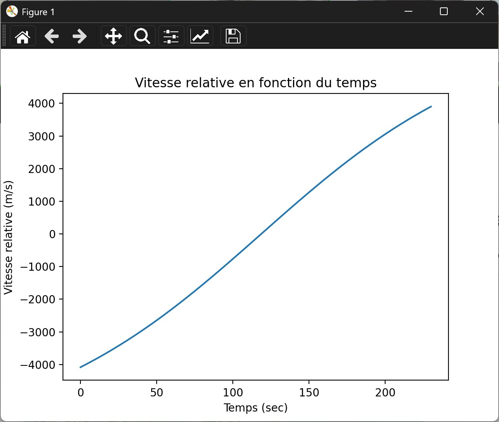
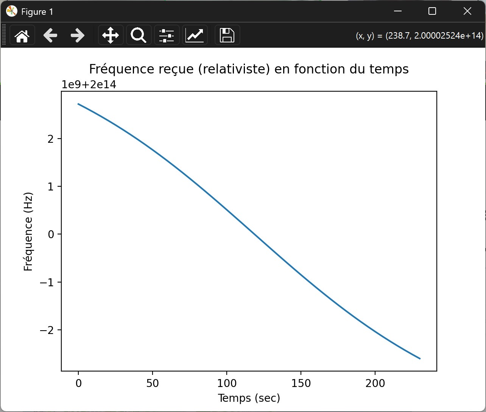
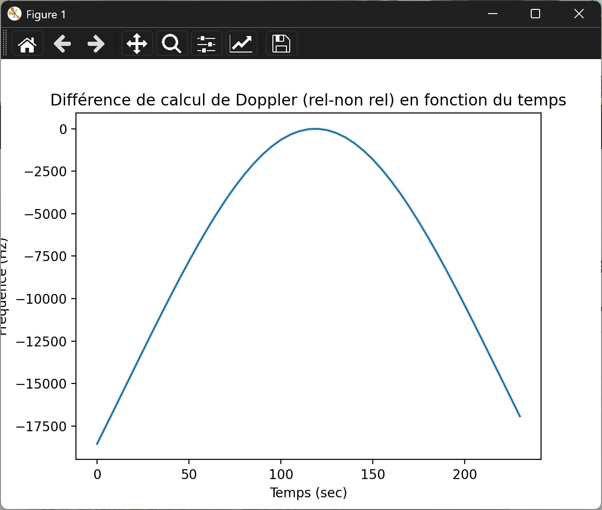

<!-- _class: titre -->

# Effet Doppler et réseaux quantiques par satellite

## Comment la vitesse d'un satellite perturbe l'interférence des photons

<br>

**Alexis Durieu · Tom Dugail · Baptiste Gimenez · Maxime Lussien**
Télécom Paris — Projet Artishow 2025-2026

<!--
NOTES ORATEUR — Slide titre

Bonjour à tous. On va vous présenter notre projet qui porte sur l'effet Doppler dans le contexte des communications quantiques par satellite.

En une phrase : un satellite se déplace très vite, ça décale la fréquence de la lumière qu'il envoie, et ça pose un vrai problème pour faire de la physique quantique. Notre objectif est de quantifier cet impact.

Ce projet mobilise de la mécanique spatiale, de la relativité restreinte et de la physique quantique — on va essayer de vous rendre ça accessible en 10 minutes.
-->

---

<!-- _class: interlude -->

# Partie 1
## Simulation orbitale

<!--
NOTES ORATEUR — Interlude

Avant de parler de quantique, il faut d'abord savoir où est le satellite et à quelle vitesse il va. C'est l'objet de la première partie.
-->

---

# Représenter l'orbite d'un satellite

<div class="columns">
<div>

### Deux repères fondamentaux

**ECI** *(Earth-Centered Inertial)*
Fixe par rapport aux étoiles lointaines. La Terre tourne *sous* le satellite.
→ Idéal pour appliquer les lois de Newton et propager l'orbite.

**ECEF** *(Earth-Centered Earth-Fixed)*
Solidaire de la rotation terrestre. Le satellite se déplace *par rapport à la surface*.
→ Idéal pour localiser une station sol.

</div>
<div>

### Les paramètres orbitaux (TLE)

Un **TLE** (Two-Line Element) encode l'état complet d'un satellite à un instant donné :

- Inclinaison, excentricité, demi-grand axe
- Anomalie moyenne, mouvement moyen
- Terme de freinage atmosphérique (BSTAR)

```
1 41731U 16051A   24016.15...
2 41731  97.3167 289.0989 0012522
  59.2544 300.9930 15.34373256...
```

*TLE du satellite Micius (SATCAT 41731)*

</div>
</div>

<!--
NOTES ORATEUR — Repères orbitaux

Pour simuler le mouvement d'un satellite, il faut choisir un repère de référence.

Le repère ECI est le plus pratique pour les calculs : il est quasi-inertiel, c'est-à-dire que les lois de Newton s'y appliquent sans avoir à ajouter des forces fictives liées à la rotation de la Terre. Dans ce repère, la trajectoire du satellite est une belle ellipse stable.

Le repère ECEF, lui, tourne avec la Terre. Si on trace la trajectoire d'un satellite dedans, on obtient une courbe complexe qui balaye la surface de la planète. C'est utile pour trouver les passages au-dessus d'une station.

Pour passer de l'un à l'autre, on fait juste une rotation : la Terre fait un tour en 24h, donc en t secondes elle a tourné d'un angle connu.

Le TLE, c'est le format universel pour décrire où est un satellite. C'est deux lignes de chiffres qui codent tous les paramètres orbitaux. On les récupère gratuitement sur des bases de données publiques (Space-Track, Celestrak).
-->

---

# Moteur de simulation : Orekit

<div class="columns">
<div>

**Orekit** est un moteur de mécanique spatiale open-source développé par CS Group pour le CNES. On l'utilise via son wrapper Python.

Il nous fournit :
- La propagation orbitale (SGP4 à partir du TLE)
- La détection d'événements (passages au-dessus d'un seuil d'élévation)
- Les transformations de repères (ECI ↔ ECEF ↔ repère station)

### Détection des créneaux de visibilité

```python
detecteur = ElevationDetector(station.frame)
    .withConstantElevation(math.radians(10))
    .withHandler(handler)
```

Seuil d'élévation : **10°** au-dessus de l'horizon.

</div>
<div>

### Architecture du code

```
run.py
│  Point d'entrée unique
│  Paramètres utilisateur
│  Sélection des graphiques
│
├── model.py
│     Satellite (TLE + propagateur)
│     GroundStation (lat/lon/alt)
│
├── detection.py
│     Créneaux de visibilité
│     VisibilityHandler (Orekit)
│
├── orbit.py
│     Boucle de simulation
│     Fonctions de tracé
│
└── physics.py
      Doppler classique
      Doppler relativiste
```

</div>
</div>

<!--
NOTES ORATEUR — Orekit

On avait le choix entre plusieurs bibliothèques Python pour la mécanique spatiale : Skyfield, Poliastro, SatOptLink... On a choisi Orekit parce que c'est le moteur le plus complet et le plus utilisé professionnellement — c'est celui du CNES et de l'ESA.

Le principe : on lui donne un TLE, il calcule la position et la vitesse du satellite à n'importe quel instant via l'algorithme SGP4 (un modèle de propagation standard pour les satellites en orbite terrestre).

Pour la simulation, on lui demande aussi de détecter automatiquement les moments où le satellite passe au-dessus de notre station sol avec un angle d'élévation suffisant (10° minimum pour éviter les effets d'atmosphère rasante). Ces moments sont les "passages" — c'est pendant un passage qu'on peut faire de la communication.

Le code est organisé en modules séparés pour que chaque partie soit indépendante et testable.
-->

---

# Résultat : un passage du satellite Micius

<div class="columns">
<div>

### Configuration simulée

- **Station sol :** Paris (48.86°N, 2.35°E, 80 m)
- **Satellite :** Micius (orbite polaire, ~500 km)
- **Durée d'un passage :** ~240 secondes (4 min)
- **Élévation minimale :** 10°

### Ce qu'on observe

La vitesse radiale satellite-station varie de **−4 000 à +4 000 m/s** au cours d'un passage.

- Négatif : le satellite s'approche (blue-shift)
- Positif : le satellite s'éloigne (red-shift)

</div>
<div>



</div>
</div>

<!--
NOTES ORATEUR — Résultat vitesse

Voici ce que notre simulateur produit pour un passage réel du satellite Micius au-dessus de Paris.

La courbe montre la vitesse radiale, c'est-à-dire la composante de la vitesse du satellite projetée sur l'axe qui relie le satellite à la station sol. C'est cette composante-là qui crée l'effet Doppler — pas la vitesse totale.

Au début du passage, le satellite s'approche : vitesse radiale négative (−4 km/s). Il passe ensuite au-dessus et repart dans l'autre sens : vitesse positive (+4 km/s).

Important : on prend en compte le temps de trajet de la lumière dans le calcul. Quand on regarde la position du satellite, la lumière met quelques millisecondes à arriver. La station "voit" donc le satellite à sa position passée, pas sa position actuelle. On corrige ça dans le code.

Un passage dure environ 4 minutes. C'est la fenêtre utile pendant laquelle on peut faire de la communication.
-->

---

<!-- _class: interlude -->

# Partie 2
## L'effet Doppler relativiste

<!--
NOTES ORATEUR — Interlude

Maintenant qu'on sait où est le satellite et à quelle vitesse il va, on peut calculer le décalage fréquentiel qu'il provoque.
-->

---

# Doppler classique vs relativiste

<div class="columns">
<div>

### Formule classique

$$f_{\text{reçue}} = \frac{f_0}{1 + v_r/c}$$

Valable pour $v \ll c$.

### Formule relativiste

$$f_{\text{reçue}} = f_0 \sqrt{\frac{1 - v_r/c}{1 + v_r/c}}$$

Valable à toute vitesse.

<div class="box">

**Pourquoi la correction relativiste ?**
À 7,5 km/s, v/c ≈ 2,5 × 10⁻⁵. La différence entre les deux formules atteint **~18 kHz** à 200 THz — non négligeable face à une largeur spectrale de ~100 MHz.

</div>

</div>
<div>

### Prise en compte du temps de trajet

La vitesse radiale effective n'est pas celle du satellite *maintenant*, mais celle qu'avait le satellite *quand la lumière a été émise* :

```python
norme_diff = np.linalg.norm(p_sat - p_station)
variation_temps = norme_diff / c
p_station_corrigee = station.position(
    date + timedelta(seconds=variation_temps)
)
```

La station sol n'est pas immobile non plus : elle tourne avec la Terre (~460 m/s à l'équateur).

</div>
</div>

<!--
NOTES ORATEUR — Formules Doppler

L'effet Doppler, tout le monde connaît le son d'une ambulance qui passe — le son monte en fréquence quand elle s'approche, baisse quand elle s'éloigne. C'est exactement le même phénomène pour la lumière.

La formule classique suffit pour des vitesses faibles. Mais pour être rigoureux, on utilise la formule relativiste qui tient compte du fait que le temps lui-même se contracte quand on se déplace vite (dilatation temporelle).

La différence entre les deux ? ~18 kHz pour une fréquence optique de 200 THz. Ça peut sembler petit, mais on va voir que c'est crucial en quantique.

Autre subtilité : on corrige le temps de trajet de la lumière. La lumière met ~1,5 ms à parcourir 450 km. Pendant ce temps, la station sol a bougé (la Terre tourne). On doit donc calculer la vitesse de la station à l'instant où la lumière est arrivée, pas à l'instant où elle est émise. C'est un détail qui compte.
-->

---

# Résultats : décalage fréquentiel sur un passage

<div class="columns">
<div>



**Fréquence reçue (relativiste)**
Émission à 200 THz → décalage de **±2,5 GHz** au cours du passage

</div>
<div>



**Différence rel. − non rel.**
Écart maximal : **~18 kHz**
Maximum au début et à la fin du passage (vitesse radiale maximale)

</div>
</div>

<!--
NOTES ORATEUR — Résultats Doppler

Ces deux graphiques résument le résultat principal de la partie simulation.

À gauche : la fréquence reçue au sol. Le satellite émet à 200 THz (lumière infrarouge, typique des lasers de communication). Au début du passage, le satellite s'approche donc la fréquence monte (+2,5 GHz). À la fin, il s'éloigne et la fréquence descend autant.

À droite : la différence entre le modèle relativiste et le modèle classique. Elle est maximale en début et fin de passage (quand la vitesse radiale est la plus grande) et s'annule au zénith. L'écart est de ~18 kHz.

Maintenant la vraie question : est-ce que 2,5 GHz de décalage, c'est beaucoup ou peu pour la physique quantique qu'on veut faire ?
-->

---

<!-- _class: interlude -->

# Partie 3
## Impact sur les communications quantiques

<!--
NOTES ORATEUR — Interlude

C'est la partie la plus récente de notre travail, encore en cours. On va vous expliquer le problème physique et ce qu'on cherche à quantifier.
-->

---

# Distribution d'intrication et mesure de Bell

<div class="columns">
<div>

### Le scénario physique

1. Le satellite **Micius** génère des paires de photons **intriqués** en polarisation
2. Il envoie un photon vers la **station A** et un vers la **station B**
3. Chaque station effectue une **mesure de Bell** (interférence sur un séparateur de faisceaux)
4. Les corrélations mesurées permettent de distribuer une **clé secrète** (QKD)

<div class="box">

**Condition critique :** pour qu'une mesure de Bell réussisse, les deux photons doivent être **indiscernables** — notamment à la même fréquence.

</div>

</div>
<div>

### L'effet Hong-Ou-Mandel (HOM)

Deux photons identiques entrant simultanément dans un séparateur de faisceaux 50/50 **ressortent toujours ensemble** — jamais un de chaque côté.

→ C'est la signature de leur indiscernabilité.

Si les photons diffèrent en fréquence de Δf, l'interférence est **partielle** :

$$\eta(\Delta f) = \exp\!\left(-\frac{(\pi \,\Delta f\, \tau)^2}{2\ln 2}\right)$$

où τ est la durée de cohérence du photon (∝ 1/σ).

</div>
</div>

<!--
NOTES ORATEUR — HOM et Bell

On entre dans la partie la plus délicate du projet. Je vais essayer d'être clair.

L'intrication quantique, c'est une corrélation entre deux particules qui ne peut pas s'expliquer par la physique classique. Si on envoie un photon intriqué à chacune de deux stations distantes, les mesures des deux stations sont corrélées de façon non locale.

Pour exploiter ça en cryptographie, on fait une "mesure de Bell" : on prend deux photons, on les fait interférer sur un séparateur de faisceaux et on regarde si ils sortent ensemble ou séparément. Le résultat révèle l'état quantique de la paire.

L'effet Hong-Ou-Mandel est l'expérience fondamentale qui montre ça : si deux photons sont vraiment identiques, ils sortent toujours du même côté. C'est une conséquence directe de la statistique bosonique.

Mais si les deux photons ont des fréquences légèrement différentes — à cause du Doppler par exemple — ils ne sont plus identiques, et l'interférence est moins bonne. La visibilité de l'interférence chute.

La formule qu'on vous montre donne la visibilité en fonction du décalage Δf et de la durée de cohérence du photon. Plus le photon est "spectralement étroit" (longue durée de cohérence), plus il est sensible à un petit décalage.
-->

---

# Organisation du groupe

<div class="columns">
<div>

### Planning en 5 phases

| Phase | Période | Livrable |
|-------|---------|---------|
| 1 – Bases théoriques | Fév | Repères, TLE, choix des outils |
| 2 – Simulation orbitale | Mar | Simulateur fonctionnel, graphiques |
| 3 – Doppler | Mar–Avr | Module Doppler validé |
| 4 – Impact quantique | Avr–Mai | Visibilité HOM vs temps |
| 5 – Consolidation | Mai–Juin | Rapport + présentation |

Réunion **chaque vendredi matin** pour synchroniser.
Encadrants : **Matteo Schiavon** et **Nicolas Fabre**.

</div>
<div>

### Mode de travail

- Chaque phase décomposée en **4 sous-tâches** (une par personne)
- Réunion de synthèse en fin de phase pour intégrer le code
- Suivi via `SUIVI.md` dans le dépôt Git (162 commits au total)

### Difficultés rencontrées

- Prise en main d'Orekit (librairie Java complexe)
- Physique quantique peu familière → réunion spéciale avec les encadrants

</div>
</div>

<!--
NOTES ORATEUR — Organisation

On a structuré le projet en 5 phases progressives, chacune avec des livrables concrets à présenter lors de nos réunions hebdomadaires du vendredi.

La répartition du travail : à chaque phase, chaque personne avait une sous-tâche précise. Par exemple en phase 1, une personne étudiait les repères orbitaux, une autre les paramètres képlériens, une autre les bibliothèques disponibles, et la dernière l'architecture du code.

En fin de phase, on se réunissait pour intégrer tout ça ensemble.

Les difficultés principales : Orekit est une vraie bibliothèque professionnelle, pas un outil pédagogique — la courbe d'apprentissage est raide. On a aussi dû refactoriser complètement le code en mai à cause d'imports circulaires. Et la physique quantique, aucun d'entre nous ne l'avait vraiment étudiée avant ce projet — on a eu une réunion de 1h30 avec nos deux encadrants pour mettre à plat les notions essentielles.
-->

---

# Enjeux sociétaux

<div class="columns">
<div>

### Ce que ce projet apporte

**Sécurité des communications**
La QKD offre un chiffrement *prouvablement* sûr — même face à un ordinateur quantique. Applicable à la protection des données d'État, bancaires, médicales.

**Science fondamentale**
Tester la mécanique quantique à grande échelle. Micius a déjà montré que l'intrication survit à 1 200 km dans l'espace.

**Souveraineté numérique**
Un réseau quantique satellite-sol permettrait des communications sécurisées indépendamment des câbles sous-marins (vulnérables physiquement).

</div>
<div>

### Ce que ce projet coûte

**Empreinte carbone des lancements**
Un satellite LEO → ~2 500 t CO₂ équivalent par lancement (fusée + fabrication). Difficile à justifier sans besoin massif avéré.

**Fracture technologique**
Technologie très coûteuse, maîtrisée par quelques États (Chine, Europe, USA). Risque d'une nouvelle asymétrie dans l'accès aux communications sécurisées.

**Dépendance à l'infrastructure spatiale**
Dépendre de satellites implique de dépendre de qui les contrôle — et d'un environnement orbital de plus en plus encombré (débris, Starlink).

</div>
</div>

<!--
NOTES ORATEUR — Enjeux sociétaux

Cette réflexion, on l'a menée collectivement. Le projet semble très abstrait et académique, mais ses implications sont réelles.

Côté positif : la cryptographie quantique, si elle se déploie à grande échelle, permet de sécuriser des communications même contre des attaques futures par ordinateurs quantiques — c'est ce qu'on appelle la "crypto post-quantique" ou "quantum-safe". Pour des données médicales, des transactions financières ou des communications diplomatiques, c'est un enjeu stratégique majeur.

Côté négatif : les satellites coûtent cher en CO2 à lancer. On parle de plusieurs milliers de tonnes équivalent CO2 par lancement. Si on déploie des constellations entières de satellites quantiques, l'empreinte environnementale devient significative.

Il y a aussi un enjeu géopolitique : aujourd'hui, seule la Chine a un satellite quantique opérationnel (Micius). L'Europe travaille à QCI (Quantum Communication Infrastructure). Si cette technologie reste concentrée dans quelques pays, elle risque de creuser un fossé de sécurité numérique entre les nations.

Enfin, la prolifération des satellites dans les orbites basses est un problème croissant — les débris orbitaux menacent l'accès à l'espace pour tous.
-->

---

# Conclusion et perspectives

<div class="columns">
<div>

### Ce qu'on a fait

- **Simulateur orbital complet** : propagation TLE via Orekit, détection de passages, repères ECI/ECEF
- **Module Doppler** : correction du temps de trajet, formule relativiste
- **Résultat clé :** décalage de ±2,5 GHz, différence rel/non-rel de 18 kHz
- **Début de modélisation quantique** : visibilité HOM en fonction de Δf

### Ce qui reste

- Courbe de visibilité η(t) sur un passage complet
- Étude paramétrique (altitude, inclinaison, σ du photon)
- Rédaction du rapport final

<!--
NOTES ORATEUR — Conclusion

Pour conclure, voici ce qu'on a fait et où on en est.

On a construit un simulateur qui va de la lecture d'un TLE jusqu'au calcul du décalage fréquentiel sur un passage satellite complet, en tenant compte de tous les effets physiques : rotation de la Terre, temps de trajet de la lumière, relativité restreinte.

Le résultat principal : ±2,5 GHz de décalage Doppler. Face à une largeur spectrale de 100 MHz pour un photon typique, ça rend l'interférence quantique quasiment impossible en début et fin de passage.

La prochaine étape, c'est de produire la courbe de visibilité HOM en fonction du temps, et de chercher quels paramètres orbitaux minimisent ce problème — par exemple des orbites plus hautes (LEO vs MEO), des passages plus courts mais plus au zénith, etc.

Merci pour votre attention, on est prêts pour vos questions.
-->
